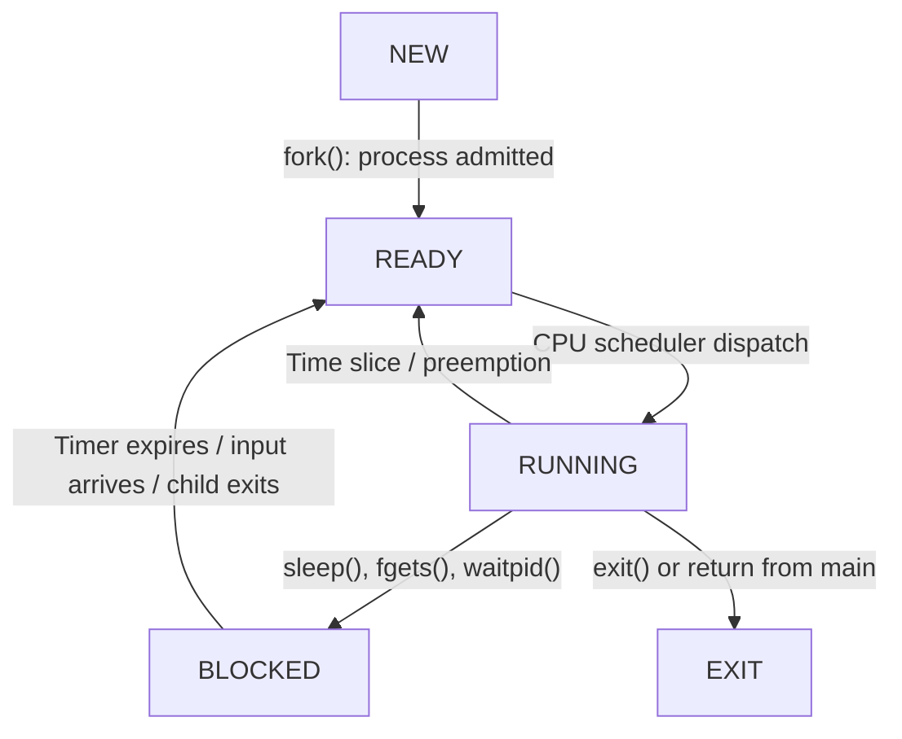

# Operating Systems — Session 2
## How Does a Program Come to Life?

### Lab A — Process Inspection

I investigated the process hierarchy and process states in my Ubuntu WSL2 environment.

The shell PID was 399, and its parent PID was 397.

The pstree command showed that the shell belonged to a process hierarchy managed by WSL.

PID 1 was systemd, which manages services and processes within the Ubuntu environment.

I counted the process states using ps and obtained:

| State | Number |
|---|---:|
| D | 1 |
| R | 2 |
| S | 26 |
| Total | 29 |

There were 2 runnable processes out of 29, representing approximately 6.9%.

The majority of processes were sleeping rather than actively running.

This experiment demonstrated that most processes do not continuously use the CPU.

### Lab B — Stopped Process (T)

I ran the states program and stopped it using Ctrl+Z during its computing phase.

The process had PID 2197.

The watcher displayed:

23:19:00 state=T voluntary=3 involuntary=2
23:19:01 state=T voluntary=3 involuntary=2

The process entered the stopped state (T). Its context-switch counters remained unchanged while it was stopped.

After using fg, the process resumed execution. The watcher subsequently displayed:

23:19:22 state=S voluntary=4 involuntary=2

This showed that the process had resumed and entered a sleeping state.

I stopped the process again using Ctrl+Z during its input-waiting phase. The watcher showed:

23:22:04 state=T voluntary=7 involuntary=2

These results demonstrate that a Linux process can be stopped using signals and resumed without creating a new process.

### Lab B — Uninterruptible Sleep (D)

I compiled and executed dstate.c to observe the uninterruptible sleep state.

The program used vfork() to create a child process.

The results were:

| PID | PPID | State | WCHAN |
|---|---|---|---|
| 3858 | 399 | D | kernel_clone |
| 3861 | 3858 | S | hrtimer_nanosleep |

The parent process entered state D because it had to wait for the child process to release the shared address space.

The child process entered state S because it was executing sleep(20).

This experiment demonstrated two different types of waiting in Linux.

A process in state S can normally be awakened by a signal, while a process in state D does not immediately respond to signals.

The parent cannot continue executing until the child calls exec() or _exit().

### Lab C — Ready Is Not Running

I used the `nproc` command and found that my Ubuntu WSL2 environment has 12 available logical CPUs.

Before starting the experiment, the load averages were:

0.08 0.09 0.04

The CPU was almost entirely idle, and the vmstat runnable queue was generally 0.

I then created 14 CPU-intensive processes using:

for i in $(seq 14); do yes > /dev/null & done

The ps command confirmed that all 14 processes were in state R.

Since my system has only 12 logical CPUs, all 14 processes cannot execute simultaneously. At least two must remain Ready while the others execute, assuming all 14 stay runnable.

After launching the processes, the load averages increased to:

6.22 1.61 0.55

This increase demonstrates that more processes were competing for CPU time.

The experiment shows that Linux uses the R state for both Running and Ready processes.

Finally, I terminated the test processes using pkill -x yes and verified that none remained using pgrep -a yes.

### Lab C — CPU Affinity and Context Switching

I restricted two CPU-intensive processes to logical CPU 0 using taskset.

The process IDs were 4343 and 4354.

Both processes appeared in state R.

Because both were restricted to the same logical CPU, the scheduler had to alternate between them.

I monitored PID 4343 using watch.sh.

At 23:58:49:
- Voluntary context switches: 4
- Involuntary context switches: 1143

At 23:58:55:
- Voluntary context switches: 4
- Involuntary context switches: 1917

Later, the involuntary counter reached 13543.

The voluntary counter remained unchanged, while involuntary context switches increased rapidly.

This demonstrates scheduler preemption and the Running-to-Ready transition.

Linux uses R for both Running and Ready processes.


### Lab D — Process Creation with fork, exec and wait

I compiled and executed lifecycle.c successfully.

The parent process had PID 4934, and the child process had PID 4935.

The fork() system call created the child process.

The child then executed ls -l using execlp(), which replaced the child's program without changing its PID.

Meanwhile, the parent waited for the child using waitpid(). During this wait, the parent would normally be in state S (Blocked).

The child displayed the contents of the current directory and terminated successfully.

The parent collected the child's exit status and printed:

child exited with 0

An exit status of 0 indicates successful execution.

### Lab D — Invalid Path and System Call Tracing

I modified lifecycle.c to execute ls /nothing instead of ls -l.

The parent process had PID 4980 and the child had PID 4981.

The child displayed an error because /nothing does not exist and exited with status 2.

I confirmed this result by running ls /nothing directly and checking its exit status using echo $?. The result was also 2.

I then traced the program using strace.

The trace showed that the parent created child process 5011 using clone().

The child attempted to execute ls from several directories:

- /usr/local/sbin/ls — ENOENT
- /usr/local/bin/ls — ENOENT
- /usr/sbin/ls — ENOENT
- /usr/bin/ls — success

This demonstrates that execlp() searches the directories listed in PATH to locate an executable.

After the child terminated with status 2, the parent collected its exit status through waitpid().

The experiment helped me understand how processes are created, how a child executes another program, and how its parent receives the result.

### Lab D — Zombie Process

I compiled zombie.c and executed it in the background.

The parent process had PID 5089, and the child process had PID 5091.

The child terminated immediately, while the parent continued sleeping for 30 seconds without calling wait().

I used ps -l to inspect the process states.

The parent was in state S, while the child was in state Z.

This demonstrated that a zombie is a process that has already finished executing but whose exit status has not yet been collected by its parent.

In the five-state process model, a zombie corresponds to the Exit (Terminated) state.

A zombie cannot be removed by kill -9 because it is already dead. Its remaining process entry must be reaped by its parent or an appropriate adopting process.

### Lab D — Orphan Process

I compiled and executed orphan.c to observe what happens when a parent process terminates before its child.

The parent process had PID 5562, and its child had PID 5564.

Initially, the child displayed:

child 5564: my parent is 5562

After the original parent terminated, the child displayed:

child 5564: my parent is 5473

I used ps to inspect the child and found that it was still running with PPID 5473 and state S.

I then checked /proc/5473/comm and found that the adopting process was named Relay(5476).

This demonstrates that Linux does not automatically terminate a child process when its parent exits. Instead, the child is reparented to another process, which can later collect its exit status.

An orphan is not a separate process state. It describes a child whose original parent has terminated.

### Lab E — Suspended Processes

I created two processes using sleep 1000 and yes.

The sleep process had PID 5642 and was initially in state S. The yes process had PID 5653 and was initially in state R.

After sending SIGSTOP to both processes, I observed that both changed to state T.

I then used SIGCONT to resume them. The sleep process returned to state S, while the yes process returned to state R.

This demonstrates that a process can be stopped and resumed without losing its execution context.

I also examined the system's memory using free -h.

The system had 7.4 GiB of RAM, approximately 6.9 GiB available, and 2.0 GiB of swap space.

No swap space was being used. The sampled VmSwap values were all 0 kB.

A process in Linux state T is stopped by a signal but generally remains in virtual memory, with no requirement that its resident memory pages be swapped out.

In the textbook Ready/Suspend state, a process is ready to execute but has been suspended outside main memory and must be brought back before being scheduled.

Finally, I terminated both experimental processes and confirmed that they were no longer running.

### Bug Hunt — The printf That Printed Twice

I compiled and executed buffer.c to investigate the behavior of printf() when combined with fork().

When I ran the program normally, it printed one line:

parent pid=5813

However, when I redirected its output to out.txt, the same message appeared twice:

parent pid=5824
parent pid=5824

This happened because standard output is normally line-buffered when connected to a terminal but fully buffered when redirected to a file.

When fork() was called, the parent and child both inherited a copy of the unflushed output buffer. When both processes terminated normally, each flushed its buffer, producing duplicate output.

To correct the problem, I added fflush(stdout) immediately before fork().

After recompiling and redirecting the output again, the message appeared only once:

parent pid=5867

This experiment demonstrated the relationship between standard I/O buffering, process creation, and output redirection.

## Five-State Process Model



### Interpretation

New to Ready: A newly created child process becomes eligible for CPU scheduling.

Ready to Running: The Linux scheduler selects a runnable process to execute on a CPU.

Running to Ready: A CPU-bound process may be preempted, as demonstrated by the taskset experiment.

Running to Blocked: A process waits for a timer, keyboard input, or child termination.

Blocked to Ready: The process becomes runnable when the awaited event occurs.

Running to Exit: A process finishes execution or terminates.

Linux state R represents both Ready and Running, while S and D represent different forms of waiting. A zombie remains as a terminated process awaiting reaping.
```
